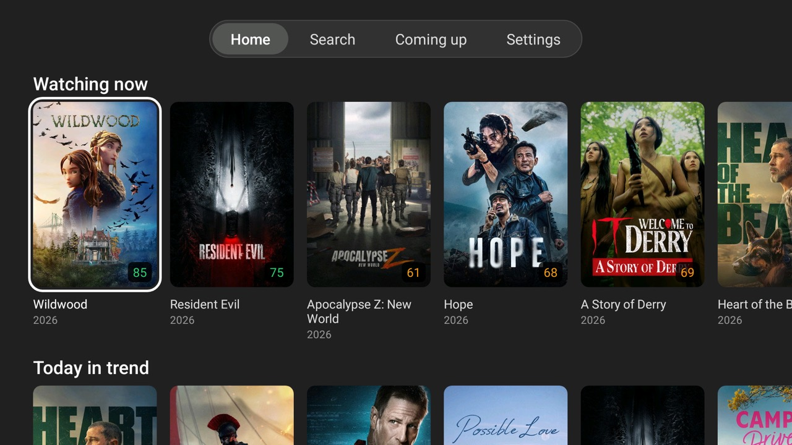
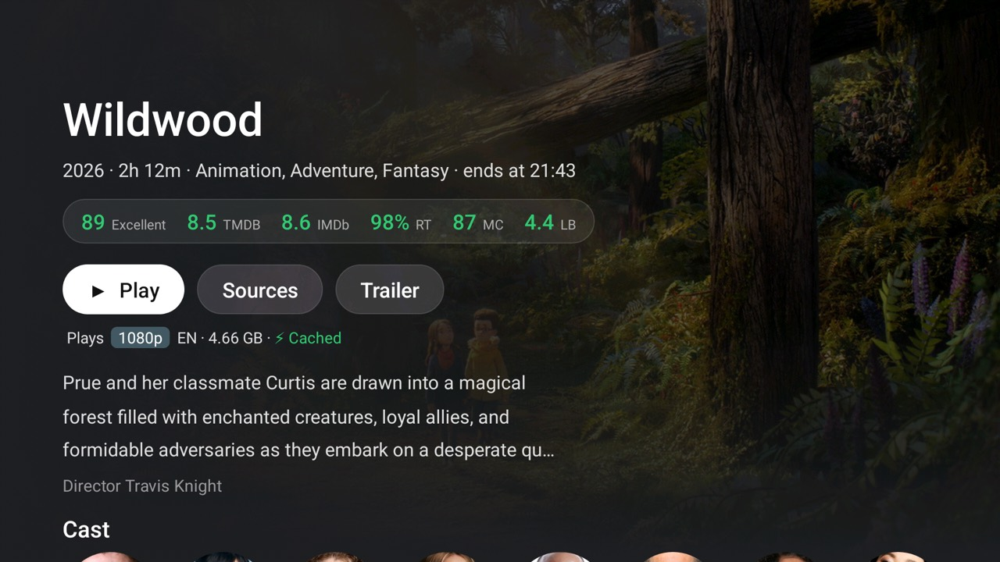

# Lampa Native

An unofficial native Android TV app in the spirit of [Lampa](https://github.com/yumata/lampa): browse films and
series from TMDB, pick a release, and play it from your TorBox account in
[DDD player](https://github.com/usmanec/dddplayer). Built for a Fire TV Stick 4K (Android 11, 1.7 GB RAM), so it
uses as little memory and CPU as it can: plain Java views, no libraries, no Gradle.

<p>
  
  
</p>

Measured on the stick (the same 39 remote presses; details in [PLAN.md](PLAN.md)):

| | Lampa (web app) | Lampa Native |
|---|---|---|
| Memory on Home | 386–417 MB | 25–32 MB (software drawing), 55–76 MB (GPU) |
| CPU while scrolling | 6–14 % | 3–11 % |
| CPU idle on a screen | 3–8 % | 0 % |

## What it does

- Home: Continue browsing, My list, For you, New in 4K and TMDB's rows; a tab bar with Search, Coming up and Settings.
- Film and series pages: scores (TMDB, IMDb, Rotten Tomatoes, Metacritic, Letterboxd), cast, collection, trailer,
  seasons and episodes with watch marks, Story so far, More like this, a person's films, follow a person.
- Sources: a Torrentio-style Stremio addon's releases filtered by audio language, TorBox's cached ones marked, each
  cached one's audio per language read from its file ("RU DD+ 7.1", "EN TrueHD Atmos"); ▶ Play picks the biggest
  cached one in your languages.
- Plays in DDD player with the resume point, and keeps it in sync with Lampa (resume points through the worker,
  history, My list, marks and grades through a CUB account).
- Voice search with the Fire TV remote's microphone button.
- Settings: software or GPU drawing, a memory and CPU overlay, CUB account and profile, audio languages.

## How it works

```
TV: Lampa Native ──https──▶ your worker (Cloudflare Workers, free plan) ──▶ TMDB, MDBList, CUB, TorBox,
        │                     KV + D1, cron jobs, keys kept as secrets        a streams addon
        └── intent ──▶ DDD player ──▶ TorBox's link
```

The TV does as little as it can: the worker merges each screen into one small JSON answer and holds the API keys
(TMDB, TorBox, MDBList), so none is on the TV or in the APK. Everything is yours: you deploy the worker to your own
Cloudflare account. Besides it, the app talks to TMDB's image server, CUB (sign-in), the streams addon directly when
the addon refuses the worker (so its address must carry no key), the home server if your build has one, and whatever
app opens YouTube links for trailers.

## You need

- An Android TV device with Android 11 or later (a Fire TV on Fire OS 8, such as the 2023 Fire TV Stick 4K, a Chromecast with Google TV, …) and
  [adb](https://developer.android.com/tools/adb) on a computer, with ADB debugging on in the TV's developer options.
- [DDD player](https://github.com/usmanec/dddplayer/releases) on the TV.
- A [TorBox](https://torbox.app) account (paid) and a [TMDB API key](https://www.themoviedb.org/settings/api) (free).
- The address of a Torrentio-style [Stremio addon](https://github.com/Stremio/stremio-addon-sdk) (its stream titles
  carry 👤 seeders, 💾 size and language flags).
- A free [Cloudflare](https://dash.cloudflare.com/sign-up) account and Node.js 22+ for the worker.
- Optional: a [CUB](https://cub.red) account (Lampa's sync: history, My list, marks, grades shared with Lampa) and an
  [MDBList](https://mdblist.com) key (more scores).

## Setup

1. **The worker.** In `worker/`: `npx wrangler@4 login`, then `./setup.sh` (it makes the KV namespace, the D1
   database and its tables, and deploys; `NAME=<name>` to call it something else than `lampa-native`). Then its
   secrets, as setup.sh lists them (on a Mac the two key scripts read the clipboard, so copy the key first; elsewhere
   they ask):

   ```sh
   ./set-tmdb-key.sh                          # TMDB (checked before it's stored)
   ./set-torbox-key.sh                        # TorBox (checked before it's stored)
   npx wrangler@4 secret put STREAM_ADDON     # the streams addon's address, without /manifest.json and no key in it
   npx wrangler@4 secret put MDBLIST_API_KEY  # optional
   ```

2. **The app.** Download the APK from [Releases](../../releases) or build it (below), then
   `adb connect <tv ip>:5555` and `adb -s <tv ip>:5555 install lampa-native-*.apk`.

3. **Connect the TV to the worker**, from the repository's root:

   ```sh
   WORKER=https://lampa-native.<account>.workers.dev STICK=<tv ip>:5555 tools/connect.sh
   ```

   This makes a play token (kept in `~/.config/lampa-native/play_token`), stores it in the worker, hands the
   worker's address and the token to the app over adb, and prints the app's answer: `setup: connected to …`. The app
   takes them together and only while it has neither, so another app can't point it elsewhere; if one did first,
   the answer says `setup: kept <its worker>`. To connect again: `adb shell pm clear local.lampanative` first.
   Every request the app makes to the worker carries the token. Playing, sources, resume points, voice and TorBox's
   account need it, and the film page (it spends the MDBList key); the other TMDB screens (home, seasons, person,
   search, genres, discover) stay open, cached at Cloudflare's edge.

4. **Optional:**
   - CUB: Settings → CUB account shows a code to confirm at cub.red. The worker serves only the CUB accounts you list:
     run `npx wrangler@4 tail` in `worker/`, open Home, and it logs `CUB account <id> isn't in CUB_ACCOUNTS`;
     then `npx wrangler@4 secret put CUB_ACCOUNTS` with that id (comma-separated for several).
   - Voice search: `adb shell pm grant local.lampanative android.permission.RECORD_AUDIO`. Fire OS takes it back
     at every boot; on a rooted stick `tools/stick/grant-mic.sh` (a Magisk boot script) gives it back.
   - Skip times: `worker/set-theintrodb-key.sh` (TheIntroDB, more requests a day).
   - A home server: `worker/home-server/` has Claude Code for voice search and Story so far (`voice-claude.py`) and
     an intro finder by sound (`intro-detect.py`), for a Mac at home; the plists say where the files go (the play
     token in `~/.lampa-intros/play_token`, the worker's address in `~/.lampa-intros/worker`). Voice search there
     runs Claude Code under your own sign-in, so check your plan allows it. Build the app with
     `HOME_SERVER=<ip>:8790` (in `app/local.env`): it then talks plain http to that address only, with a token made
     from the play token.

The app shows the worker it uses and TMDB's notice under Settings → Worker and About. If you also use the
[Lampa TorBox plugin](https://github.com/fedossayenko/lampa-torbox-en), the worker can be its CORS proxy too:
`PASS_THROUGH = "1"` under `[vars]` in `worker/wrangler.toml` (off by default: `?url=` and `/mdblist` are open to
anyone and spend your MDBList key).

## DDD player

The app hands the film to `top.rootu.dddplayer` with the resume point and gets the position back when you leave the
player. A [fork](https://github.com/fedossayenko/dddplayer/tree/feat/audio-lang-extra) adds what the app sends
on top: the audio language and tracks you picked last time, skip intro/recap/credits, a next-episode card, the
position every 30 seconds (so a power cut loses nothing). Stock DDD ignores those and plays all the same.

## Development

```sh
app/build.sh                # app/build/lampa-native.apk (SDK build-tools 36.1.0, platform 36, JDK 21; ANDROID_HOME)
tools/check.sh              # shellcheck, javac -Xlint:all -Werror, the app's host tests and the worker's
tools/lint.sh               # Android Lint, warnings as errors (after build.sh)
tools/install-hooks.sh      # once per clone: check.sh before each commit, + build and lint before each push
ANDROID_SERIAL=<tv>:5555 tools/install.sh   # install and compile ahead of time (rooted: also deletes older installs' compiled code)
ANDROID_SERIAL=<tv>:5555 tools/measure.sh local.lampanative   # memory, CPU and frames over 39 presses
```

- Logic lives in classes that import nothing from `android.*` and is tested on the computer's JVM first
  (`app/test`, `tools/TestRunner.java`); `Main.java` and its screens (`Discover`, `Episodes`, `SearchScreen`,
  `SignIn`, each a `Main.Part`) are the view glue, `Net.java` the HTTP.
- Every change keeps to [PLAN.md](PLAN.md)'s budgets and design rules (no libraries, no animations, nothing kept in
  memory while the player plays) and is measured on a real stick. PLAN.md is also the log of every measurement.
- The worker: `worker/cloudflare-worker.js`, tests in `worker/native.test.js` (`node --test`, fetch mocked).
- `tools/emulator.sh` runs an Android TV emulator shaped like the stick, for looking at screens.

Pull requests are welcome; please run `tools/check.sh` first. Security problems: please report them privately
through GitHub's security advisories, not in an issue.

## Disclaimer

Lampa Native is not made by, affiliated with or endorsed by Lampa, CUB, TorBox, Stremio, Torrentio, DDD player or
TMDB. It hosts no media and has no built-in source: it shows what the services you configure return, through a
worker you deploy yourself. You are responsible for what you watch and for following the law where you live and the
terms of the services you use. CUB's API is undocumented and may change; the app signs in to it as Lampa's device
login does.

 This application uses TMDB and the TMDB APIs but is not
endorsed, certified, or otherwise approved by TMDB.

## License

[MIT](LICENSE)
